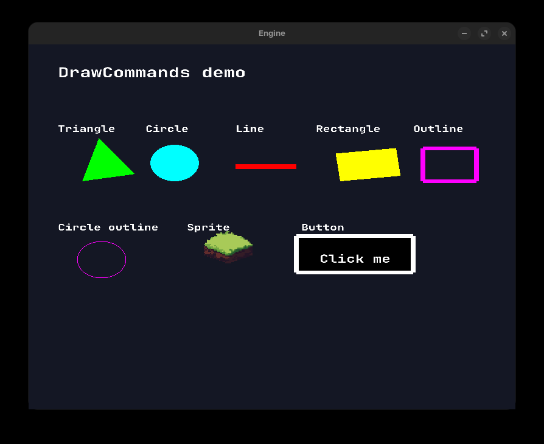

# Image assets

Put images under `Game/Assets`. Nested files are copied automatically to both build and publish output. Bootstrap uses `FileAssetSource(Path.Combine(AppContext.BaseDirectory, "Assets"))`; no database import or startup image scan is needed.

```csharp
// In IGame.Initialize, using the supplied TextureAssets:
var grass = textures.Load("Terrain/Grass/tile_022");
// In Render:
graphics.DrawSprite(grass, -0.4f, 0.2f, 0.3f, 0.3f, EngineColor.White);
```

`Load` resolves and validates the identifier without decoding the image or creating a GPU resource. The first draw (or `Preload`) decodes RGBA pixels and uploads once. Later draws reuse the GPU texture. Missing files fail at registration; corrupt image contents fail at first use with an `InvalidDataException` containing the asset name and path.

Relative names accept `/` or `\`, repeated separators and `.` segments. Explicit extensions and extensionless requests for the same file share a logical handle. Extensionless resolution checks `.png`, `.jpg`, `.jpeg`, `.bmp`, `.gif` in that order, without scanning directories. Filename case follows the operating system. GIF uses the existing decoder's first-frame behavior; animation is not supported. Absolute paths, parent traversal, symbolic links and reparse points are rejected, including links introduced after registration. The asset directory must be trusted against concurrent filesystem mutation; this is not an atomic sandbox for hostile writers.

```csharp
textures.Preload(grass);             // Optional explicit decode/upload.
textures.Preload(new[] { grass });   // Preload an explicit batch.
textures.Unload(grass);              // Destroy GPU residency, keep the logical handle.
// The next draw reconstructs the GPU texture.
textures.Reload(grass);              // Discard cached source pixels and upload current contents.
textures.Remove(grass);              // Permanently unregister; old handle becomes invalid.
```

Unload, reload and remove textures between rendered frames, after queued drawing commands have been flushed. `TextureAssets`, its handles, and graphics operations belong to the graphics thread. OpenGL calls require that thread's current context. A removed slot is never reused, so stale handles cannot refer to a later registration. Handles are local to their owning `TextureAssets` instance and must not be exchanged between instances.

## Memory and lifetime

Filesystem pixel buffers are released after a successful upload by default. Eviction therefore decodes from the source again. Construct `TextureAssets(backend, source, retainSourceImages: true)` to retain source buffers and avoid that decode. `Reload` refreshes source contents under either policy. Generated textures registered with `Load(name, ImageData)` always retain their pixel data for re-upload; this preserves font glyph rendering. Treat supplied generated pixel arrays as owned by the registration and do not mutate them after loading.

`RegisteredCount`, `UploadedCount` and `RetainedImageCount` expose current cache counts. Explicit removal releases generated CPU data. Disposal destroys every remaining GPU texture, clears the registrations, and is idempotent. Engine shutdown disposes texture assets before renderer resources while the context is current, then disposes input and the window.

Images contain positive dimensions and exactly `width * height * 4` RGBA bytes. The OpenGL backend uploads RGBA with alpha blending and nearest filtering, without generating unused mipmaps.

## Responsibilities and testing

- `Engine`: source contract, backend-independent handles, texture cache and lifecycle.
- `AssetPipeline`: filesystem path resolution and StbImageSharp decoding.
- `OpenGL`: GPU upload, rendering and destruction.
- `Database`: generic `Database` / `DatabaseStorage<T>` storage, independent of image import.
- `Game`: assets and usage examples; `Bootstrap`: composition.

Run `dotnet restore`, `dotnet build MiniEngine.sln`, and `dotnet test MiniEngine.sln`. The xUnit project in `tests/AssetPipeline.Tests` uses a small fake graphics backend to test lifecycle behavior without OpenGL, real terrain PNG decoding, and font rasterization/drawing. `make run` starts the graphical sample for visual verification. Streaming, hot reload, atlases and animated GIF playback are future work.


